# 写作 Agent · 本地长篇小说写作工作台

> 一个跑在自己电脑上的长篇小说写作工作台：对话写作、结构化设定库、语义检索、审稿闭环、可审阅的改动。
> Markdown 是唯一事实来源，索引只是派生物；模型、密钥、书稿都不出本机。


## 这是什么

通用写作工具的通病是「只会聊天」：它读得懂你的问题，但记不住你的角色、分不清第 80 章和第 100 章的状态、改完稿你还得自己比对差异。

写作 Agent 把写作拆成四件事，并且都落到磁盘上的文件里：

1. **对话式写作**——Agent 能读稿、改稿、续写、查设定，每一步工具调用都可见，写操作先出 diff 再决定是否落盘。
2. **作品知识库**——角色、势力、物品、地点、世界观、大纲、素材、风格八类卡片，加上章节原文，统一进检索索引。
3. **审稿闭环**——写完不是终点：独立审稿模型按设定一致性、结构、节奏、人物声音、钩子、冗余六维打分，问题回给写稿方，改到通过才标记完成。
4. **本地检索**——SQLite FTS5 关键词 + sqlite-vec 向量做混合召回，中文分词走 jieba，换模型只影响索引，不动正文。

## 架构

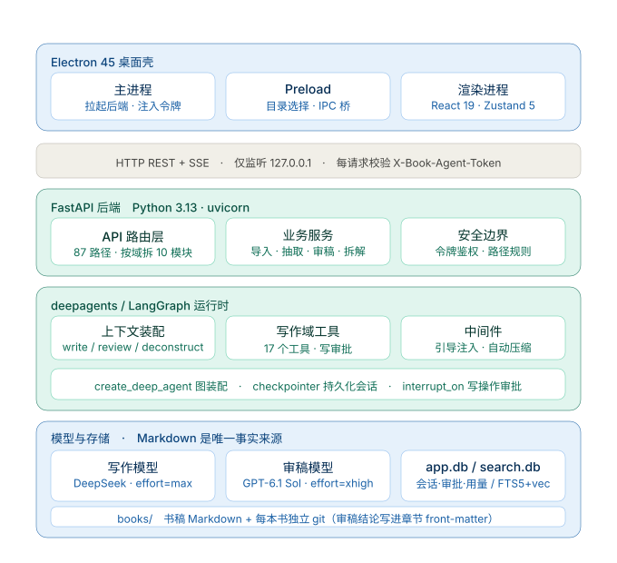

五层职责：Electron 只管界面与令牌注入，FastAPI 管业务与安全边界，deepagents 管图装配与工具循环，
Markdown 与 git 管事实，索引与 app.db 都是派生物。上下文装配按任务分三套 profile：
写稿用满 10 层，审稿刻意去掉人设与写作意图（避免替作者找理由），拆解只看源文本与输出结构。

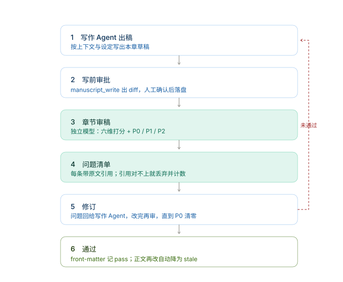

审稿不是「再问一遍模型好不好」：它用独立的模型来源（默认与写作模型不同家），
每条意见必须能引用正文原文，引用对不上就丢弃；判定由代码复核，P0 未清零或均分不足都不算通过。
通过状态写进章节 front-matter，正文一旦再改就自动降为 `stale`，避免「改完还挂着已通过」。

## 界面

| 知识库 | 召回测试 |
|---|---|
| 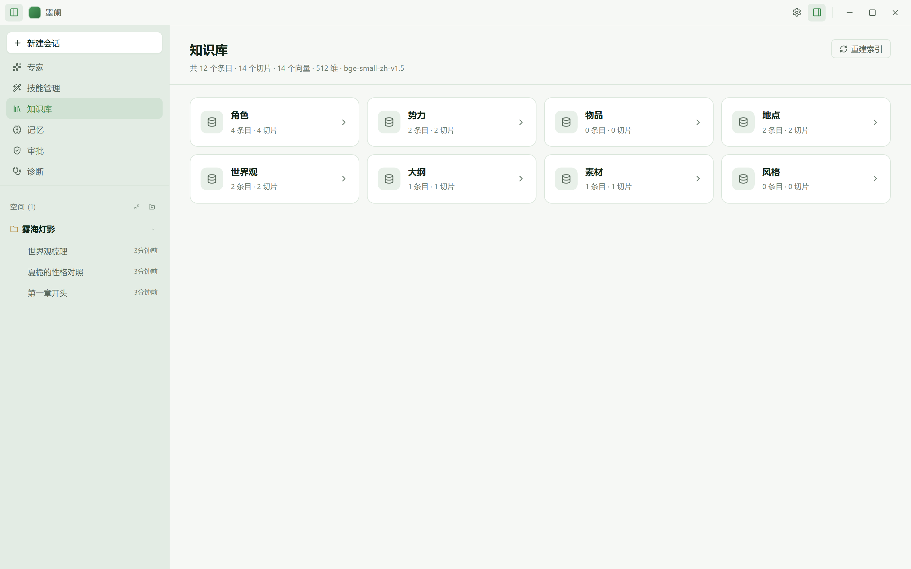 | 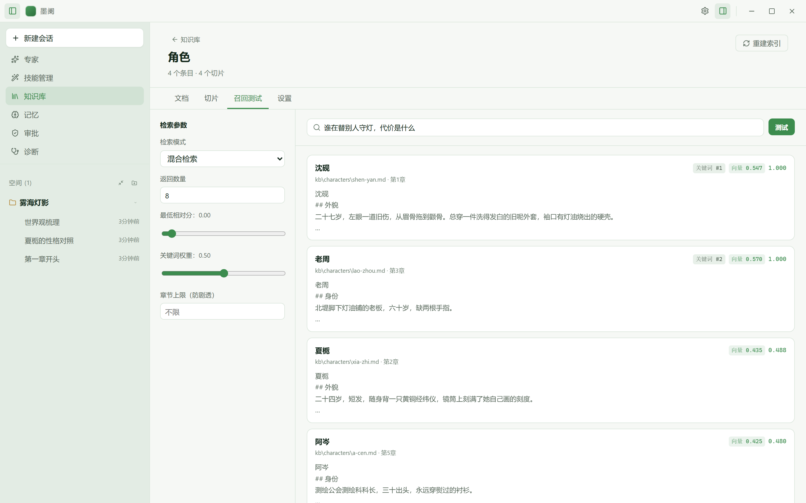 |

召回测试会同时给出**关键词名次**、**向量相似度**与融合分，能直接看出某条结果是被哪一路召回的：

| 专家 | 文件工作台 |
|---|---|
| 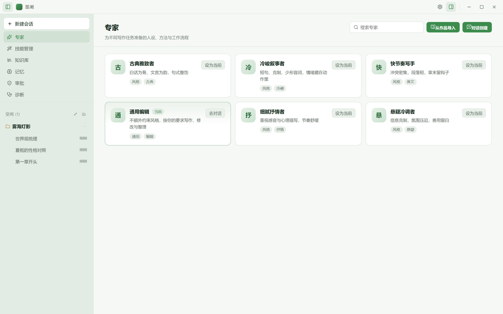 | 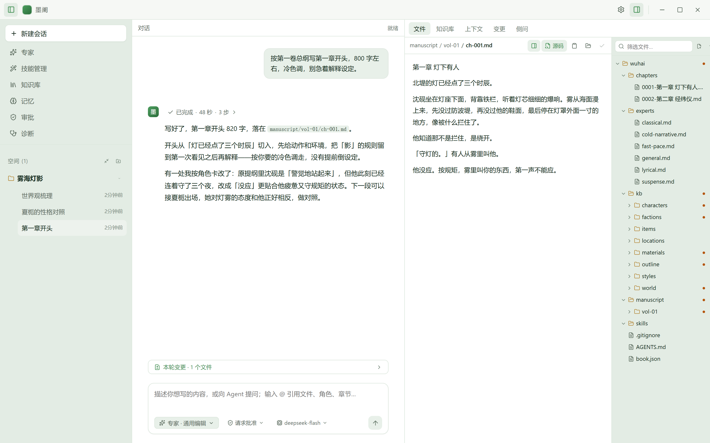 |

| 向量检索设置 | 整本书导入 |
|---|---|
| 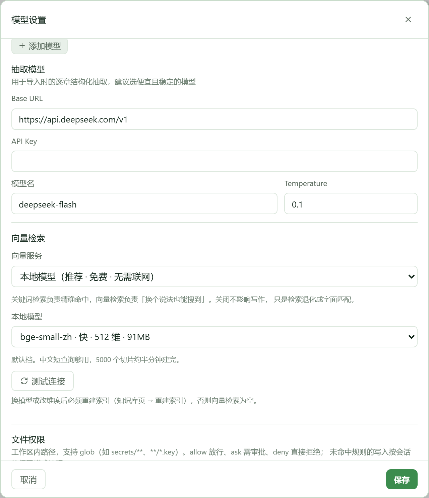 | 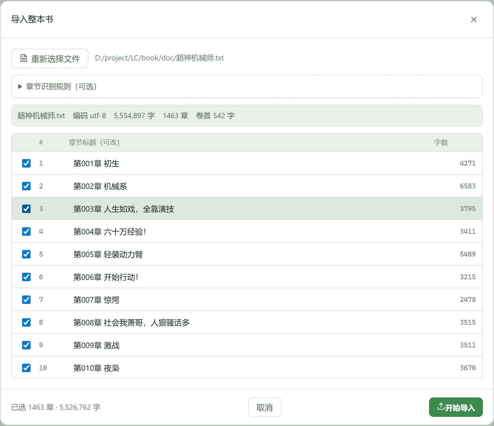 |

| 逐章抽取 | 选中改写 |
|---|---|
|  | 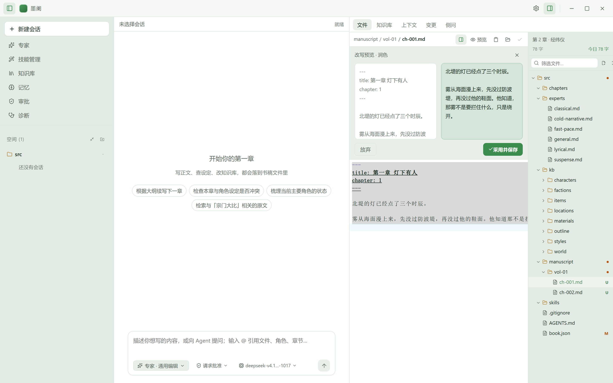 |

版本历史：每本书一个独立 git 仓库，左侧是提交流，右侧看这个提交改了什么，
「恢复此版本」要点两次才执行——第一次变成「确认恢复」，第二次才真正写回。

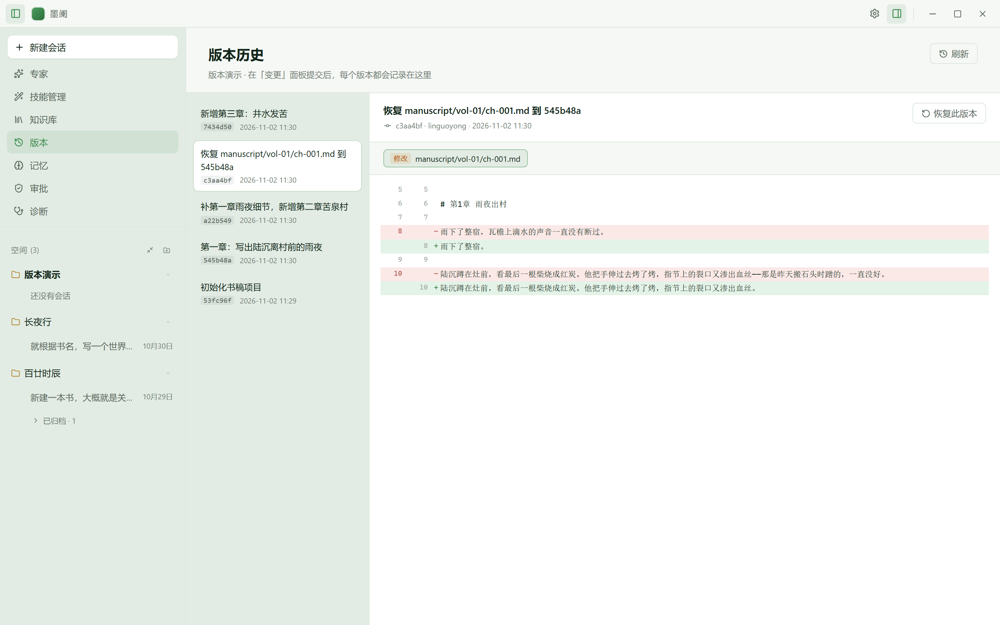

用量统计：对话、逐章抽取、选中改写分开记账，输入与缓存命中分列，
单价按自己买的渠道填，成本才算得出来。


知识库不只是卡片：关系图把角色 / 势力 / 地点 / 物品按 `meta.relations` 连起来，
虚线是「正文里提到过」自动推的；时间线把每张卡的 `timeline` 和逐章抽取的事件，
按章、按年代两条轴排开。

| 关系图 | 时间线 |
|---|---|
| 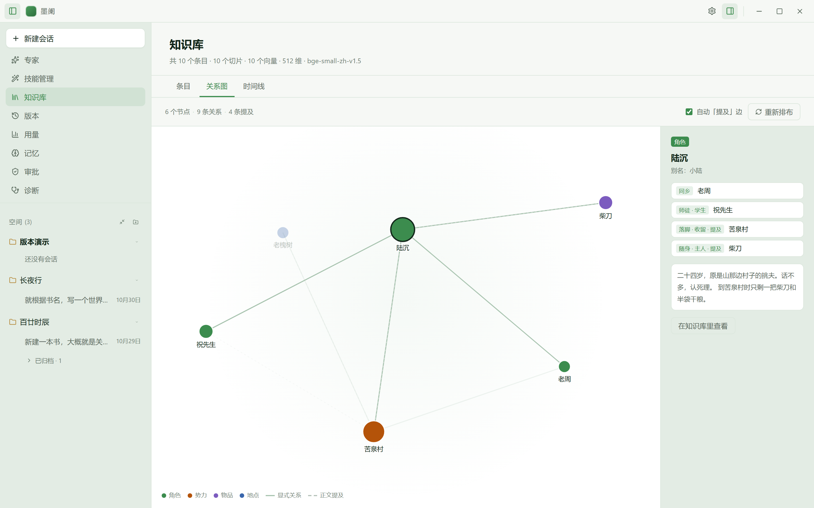 | 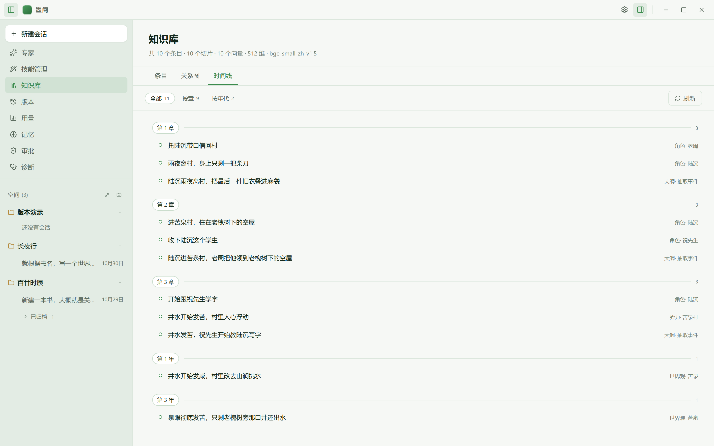 |

## 核心能力

| 能力 | 说明 |
|---|---|
| 对话写作 | SSE 流式输出；执行过程折叠为「已完成 · 用时 · N 步」，可展开看每步工具输入输出 |
| 执行中引导 | 生成过程中继续输入不会打断当前任务，引导消息在下次模型调用前注入 |
| 变更审批 | `kb_write` / `manuscript_write` / `write_file` / `edit_file` / `delete` 先中断、出 diff，逐条通过/拒绝/改参数后执行 |
| 专家与技能 | 专家＝人设（整份注入 system prompt），技能＝方法（`SKILL.md` 渐进披露）；都支持对话创建与「从作品提炼风格」 |
| 知识库 | 八类卡片 + 章节切片，按实体增量重建索引，删除条目同步清索引 |
| 整本书导入 | TXT/MD 编码探测（UTF-8/GBK/UTF-16）→ 章节识别 → 边界预览（可排除、可改名）→ 落盘并后台建索引 |
| 正文搜索替换 | 正文 / 导入章节分范围检索，支持正则与忽略大小写；替换只动正文、不动 front-matter，先预览再执行 |
| 选中改写 | 编辑器里选中一段 → 润色 / 扩写 / 压缩 → 左右对照预览 → 采用后直接替换并保存 |
| 字数与进度 | 扫描 `manuscript/` 统计算字数、章节数、今日更新，自动把「写到第几章」写回 `book.json`；文件面板常驻进度条 |
| 成稿导出 | 合并 `manuscript/` 为单文件 TXT：卷/章自然排序、自动去 front-matter、书名作者抬头，可选目录与 GBK 编码 |
| 逐章抽取 | 章节 → 结构化设定（角色/地点/势力/物品/事件/伏笔）→ 按名字与别名归并；低置信/冲突进待确认队列，已有卡片只补「自动摘要」，事件跨章去重 |
| 审稿闭环 | 写完不算完：独立审稿模型按设定一致性、结构、节奏、人物声音、钩子、冗余六维打分，问题分 P0/P1/P2 并附带原文引用；改到 P0 清零且均分 ≥3.5 才标记通过 |
| 作品拆解 | 把对标作品按 3 章一组拆成结构骨架与技法：实体直接进知识库（复用别名归并），技法写成素材卡，可额外生成一个「拆解专家」与技能 |
| 混合检索 | FTS5(jieba) 与 sqlite-vec 两路召回，RRF 融合；支持按类型、按章节上限过滤（防剧透） |
| 上下文装配 | 身份/人设/域规则/用户记忆/长期记忆/项目记忆/主会话上下文（侧问）/引用/技能/运行态 共 10 层，每层有字符预算并可查看注入清单 |
| 自动压缩 | 按所选模型的上下文窗口折算触发点，淘汰的消息先落盘再摘要，可用 `read_file` 回读 |
| 防剧透 | 角色 timeline 按当前进度裁剪，`kb_get` 只给到第 N 章，并直接返回「当前状态」 |
| 新建章节 | 文件面板一键新建，章号跨卷递增（`ch-004`），带 front-matter 并自动同步进度 |
| 记忆 | 用户 / 项目 / 长期三层 Markdown + 每日日志，显式写入、按来源标注、支持去重 |
| 侧问 | 独立 thread 的只读会话，继承主会话最近 8 条消息作为背景，结论可带回主对话 |
| 版本 | 每本书独立 git；变更页看本轮 diff / 全部 diff 并提交，版本页翻历史、看单文件 diff、一键把某个文件退回旧版 |
| 用量统计 | 每次模型调用记进 `usage_log`：按天 / 模型 / 会话 / 用途聚合，输入与缓存命中分列；填单价后折算成本，轮次摘要也显示本轮 token |
| 关系图 | 角色 / 势力 / 地点 / 物品按 `meta.relations` 连线，可叠加「正文提及」虚线；自研力导向布局，点节点看关系与正文摘要 |
| 时间线 | 汇总所有卡片的 `timeline` 与逐章抽取事件，按章 / 按年代分两条轴，可按来源过滤 |
| 素材收录 | 编辑器选中正文 →「收入素材」，按正文去重（换标题也不重复），记下来源文件与行号 |
| 连接器 | MCP 在当前版本**已停用**（工具不经过路径沙箱与审批，收益有限）；代码与配置保留，后续版本可再开 |

### 为什么不是「切块 + 向量」那么简单

普通 RAG 把小说切成等长块，角色设定会被切碎，第 100 章的状态也可能在第 80 章被检索出来。这里的做法是：

- **实体卡单独成片**：正文短于 700 字整张入库；更长时按 `##` 小节拆开（外貌 / 性格 / 成长线各成一片），避免被嵌入模型截断。
- **章节按语义边界切**：480 字一片、60 字重叠，贴近中文嵌入模型的输入上限。
- **两路融合 + 去重**：同一实体的多个切片只保留得分最高的一段，不让一张长卡刷屏。
- **章节上限下推到检索**：`chapter <= N` 同时作用于关键词与向量两路。

## 技术栈

| 层 | 选型 |
|---|---|
| 桌面壳 | Electron 45 + electron-vite 6 |
| 前端 | React 19 + TypeScript 7 + Vite 8 + Zustand 5 + CodeMirror 6 |
| 后端 | Python 3.13 + FastAPI + SSE（uvicorn，仅监听 `127.0.0.1`） |
| Agent | deepagents（LangGraph 底座）+ LangGraph SQLite checkpointer |
| 模型 | 任意 OpenAI 兼容接口，多模型来源可切换；写作 / 抽取 / 审稿三路分开配置，并可按端点填写 `reasoning_effort`（DeepSeek 支持 `max`，GPT 系支持 `xhigh`） |
| 业务存储 | SQLite（会话、消息、审批、用量记录、checkpoint） |
| 全文检索 | SQLite FTS5 + jieba |
| 向量检索 | sqlite-vec（进程内扩展）+ fastembed 本地 ONNX / OpenAI 兼容 embedding |
| 版本管理 | 每本书一个独立 git 仓库 |
| 用量记账 | `usage_log` 表按轮 / 按章记录，单价按模型配置，元每百万 token 折算 |

## 快速开始

前置：Node.js ≥ 20、pnpm 10、[uv](https://docs.astral.sh/uv/)、Python 3.13。

```bash
pnpm install          # 安装前端依赖（workspace）
pnpm dev              # 启动桌面端，Electron 会自动拉起 Python 后端
```

只跑后端或跑测试：

```bash
pnpm server           # uvicorn app.main:app --port 8787 --reload
pnpm test             # 后端单测（unittest，236 个用例）
pnpm test:web         # 前端单测（vitest，纯函数：diff 解析、格式化）
pnpm build            # 构建 renderer / main / preload
```

提交/推送前的检查（也是 CI 跑的那一套）：

```bash
pnpm hooks            # 一次性：启用 .githooks/pre-push（推送前自动跑 lint + 类型检查）
pnpm lint             # ruff check + ruff format --check
pnpm typecheck        # tsc --noEmit
pnpm check            # lint + typecheck + 两端单测 + build，一次跑全
```

想让改动进仓库前就被守住，装一次钩子即可（`git config core.hooksPath .githooks` 被 `pnpm hooks` 封装）。
钩子只做秒级的静态检查；完整验证走 `pnpm check`。
CI 配置在 `.github/workflows/ci.yml`（GitHub Actions 语法；仓库托管在 Gitee 时要换成 Gitee Go，执行的就是上面 `pnpm check` 那几条命令）。
后端依赖锁在 `server/uv.lock`、前端锁在 `pnpm-lock.yaml`，两处都用「锁文件不一致就失败」的方式安装（`--frozen`）。

打包（Windows）：

```bash
pnpm --filter desktop dist:dir       # 只出目录，验证用
pnpm --filter desktop dist            # NSIS 安装包，产物在 apps/desktop/release-win
pnpm --filter desktop dist:offline    # 同上，但用本机工具集，GitHub 不可达时用
```

`dist` 会先 `electron-vite build`，再把 Python 后端用 PyInstaller 冻成
`resources/server-bin/book-server.exe`（one-dir，约 200MB），最后打 NSIS 安装包。
装上之后不需要目标机器装 Python：后端就是随包的一个 exe，Electron 按
`BOOK_AGENT_SERVER_BIN` → `resources/server-bin/book-server.exe` → 开发态的
`server/app/main.py` 顺序找它。

- 冻结配置在 `server/book-server.spec`：jieba 词典、sqlite-vec 的 vec0.dll、
  fastembed 的动态 import 与 langchain 系列 dist-info 都显式收集，缺少会在
  启动时报 ModuleNotFoundError。
- `dist:offline` 用 `~/.book-agent/pack-tools/` 里的 NSIS 与 winCodeSign 顶掉
  electron-builder 的下载（脚本见 `apps/desktop/scripts/pack-windows.sh`）。
- 重复打包到同一个输出目录可能撞上杀软对 `app.asar` 的文件锁（报 EBUSY），
  换 `BOOK_AGENT_OUT=release-2` 再跑即可。
- 安装包未做代码签名，首次运行 Windows SmartScreen 会提示「未知发布者」。

## 目录结构

```
.
├─ apps/desktop/                 # Electron 应用
│  ├─ src/main/                  # 主进程：拉起后端、窗口、IPC
│  ├─ src/preload/               # 预加载脚本（目录选择、打开文件）
│  └─ src/renderer/src/
│     ├─ components/             # 对话、知识库、文件树、diff、审批卡…
│     ├─ views/                  # 专家 / 技能 / 知识库（条目·关系图·时间线）/ 版本 / 用量 / 记忆 / 审批 / 诊断
│     └─ store.ts                # Zustand 状态机（会话、流式、审批、UI）
├─ server/
│  ├─ app/
│  │  ├─ agent/                  # 图装配、流式运行、审批、压缩、引导、MCP、线程标识
│  │  ├─ api/routes/             # REST + SSE，按域拆分（system/projects/sessions/kb/content/files/versions/review/deconstruct）
│  │  ├─ domains/                # 域包（写作域的工具与规则）
│  │  ├─ kb/                     # 知识库仓储、检索、一致性 lint、嵌入
│  │  ├─ context.py              # 上下文装配（write / review / deconstruct 三套 profile）
│  │  ├─ review.py               # 审稿：量表、证据校验、状态回写
│  │  ├─ deconstruct.py          # 作品拆解：结构分析、实体入库、专家生成
│  │  ├─ extract.py              # 逐章抽取与实体归并
│  │  ├─ insight.py              # 素材收录、关系图、时间线
│  │  ├─ usage.py                # token 记账与成本折算
│  │  ├─ versioning.py           # git 历史、单文件 diff 与回滚
│  │  ├─ sandbox.py              # 路径 / 命令 / 网络规则
│  │  └─ memory.py               # 三层记忆
│  └─ tests/                     # 单测 276 个
└─ doc/
   ├─ 需求与架构方案.md          # 设计与变更记录（每一轮交付都记在这里）
   └─ 审稿与拆解方案.md          # 拆解调研、审稿闭环与架构调整的取舍
```

## 数据放在哪

应用仓库只放代码，书稿数据独立存放：

```
~/.book-agent/
├─ config.json          # 模型、向量服务、沙箱规则（密钥以 *** 回显）
├─ app.db               # 会话 / 消息 / 审批 / 用量记录 / checkpoint
├─ memory/              # USER.md、MEMORY.md、YYYY-MM-DD.md
├─ skills/              # 全局技能（挂到 /global-skills）
└─ books/<空间名>/
   ├─ book.json         # 书名、进度指针、每章目标字数
   ├─ manuscript/       # 正在写的卷/章
   ├─ chapters/         # 导入的原文
   ├─ kb/               # 八类知识库 Markdown
   ├─ experts/          # 项目内专家卡
   ├─ skills/           # 项目内技能
   ├─ .index/search.db  # 检索索引（派生，可重建，不进 git）
   └─ .git/
```

**原则：Markdown 文件是唯一事实来源，索引是派生物，可随时重建。**

## 检索配置

设置 → 向量检索，三选一：

| 模式 | 说明 |
|---|---|
| 关闭 | 只做 FTS5 关键词检索，开箱可用，无需下载 |
| **本地模型（默认）** | `bge-small-zh-v1.5`（512 维 / 91MB / 纯 CPU），首次启用自动下载，之后完全离线；追求质量可切 `jina-v2-base-zh`（768 维 / 640MB） |
| OpenAI 兼容接口 | 自备 `/embeddings` 端点（如 bge-m3），按量计费 |

换模型或改维度后必须重建索引（知识库页右上角），页面会检测维度不一致并提示。

重建是增量的：每个源文件按 `(mtime, size)` + 内容摘要记账，只重排改过的文件；
切片 id 由正文摘要派生，所以「改一段」只重编这一段，同章其余切片的向量原地保留。
改一个字重跑一次是毫秒级，百万字项目不必再等整本重嵌；真要从零来过用
`POST /projects/{id}/reindex?full=true`。

## 安全边界

- 后端只监听 `127.0.0.1`，所有 `/api/*` 需要 Electron 启动时生成的令牌。
  令牌只在主进程里，渲染层拿不到；每个 `/api/*` 请求由主进程在 `webRequest` 层补上请求头。
- MCP 连接器默认停用，不会启动任何本地子进程；出网只有配置里的模型与 embedding 端点。
- 窗口禁止导航、禁止开新窗（`will-navigate` / `setWindowOpenHandler`），
  拖入 HTML 或点击外链都不会把外部页面加载进应用。
- 工作区边界由 `FilesystemBackend(virtual_mode=True)` 拦截 `..`、`~`、越界绝对路径。
- 路径规则引擎对 `.env`、`secrets/**`、`*.pem`、`id_rsa*` 默认全拒绝，`.git/config` 写拒绝；规则按顺序先命中先生效。
- 写操作默认走人工审批；「完全访问」模式只跳过审批，不跳过 `deny`。
- 书稿写入是原子的（临时文件 + `os.replace`），覆盖前旧版本留在 `.index/history/`，
  进程被杀不会留下半截章节。
- 没有 shell 工具，也就没有命令面；网络访问仅限模型与 embedding 出站。

## 现状

已交付：三栏界面与窗口控制、会话与空间、专家/技能、知识库八类、@ 引用、变更审批与 diff、
一致性 lint、混合检索（FTS5 + sqlite-vec）、上下文装配与压缩、三层记忆、侧问、MCP、沙箱规则、
整本书导入、逐章抽取与实体归并、成稿导出 TXT、字数与进度、搜索替换、选中改写、
版本历史与回滚、token 用量统计、素材收录 / 关系图 / 时间线、
章节审稿（六维评分 + 原文证据校验 + 状态机）、作品拆解（结构 / 技法 / 实体 → 知识库与专家）。

批量的多章流水线（写—审—改自动推进）暂未实现：单章闭环先跑顺，再决定要不要放大到批量。
审稿默认是「提示」而不是「硬拦」——本地工具，改个错别字也被关卡拦住并不合理。

详细设计与每一轮的取舍记录在 [`doc/需求与架构方案.md`](doc/需求与架构方案.md)，
审稿与拆解的调研和改动清单在 [`doc/审稿与拆解方案.md`](doc/审稿与拆解方案.md)。

## 许可

[MIT](LICENSE) © 2026 乎游上仙 (xymylove)
